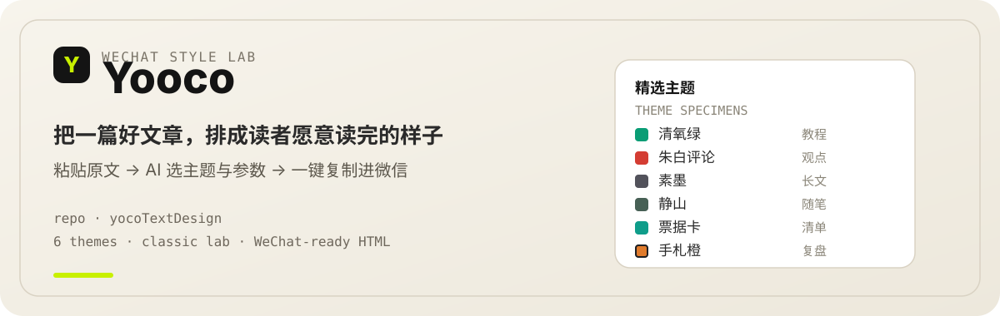
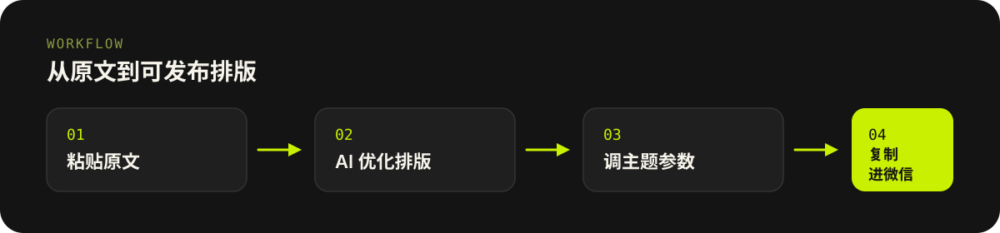

# Yooco · 公众号排版实验室

<p align="center">
  
</p>

**粘贴一篇文章，让它变成读者愿意读完、又能贴进微信后台的排版。**

仓库地址：[badboy0080/yocoTextDesign](https://github.com/badboy0080/yocoTextDesign)

---

## 它能做什么

| 能力 | 说明 |
| --- | --- |
| AI 优化排版 | 识别标题、段落、列表、引用等结构，并给出适合的主题与参数 |
| 六套精选主题 | 清氧绿、素墨、静山、票据卡、手札橙、深空青，另有「经典」走旧气质 |
| 预览即所见 | 在工作室里改字、改参数，预览同步更新 |
| 一键复制 | 生成尽量贴合微信编辑器的 HTML，带基础合规提醒 |
| 配置导入导出 | 把一套参数存成 JSON，换机器也能接着用 |


---

## 使用流程

<p align="center">
  
</p>

1. 打开工作室页面  
2. 粘贴或输入文章原文  
3. 点击「优化排版」  
4. 需要时切换主题、微调参数  
5. 点击「一键复制排版」，粘贴到微信公众号编辑器

---

## 本地启动

**环境要求：** Node.js `>= 22.13.0`

```bash
npm install
```

配置 DeepSeek 密钥（「优化排版」需要）：

在项目根目录创建 `.dev.vars`（不要提交到 Git）：

```bash
DEEPSEEK_API_KEY=你的密钥
# 可选
DEEPSEEK_MODEL=deepseek-flash
```

注册要先收邮箱里的 6 位验证码。发信使用 [Resend](https://resend.com)，密钥不要写进仓库：

```bash
RESEND_API_KEY=你的密钥
# 可选。不填时用 Resend 的测试发件地址，只能发给该账号自己的邮箱。
EMAIL_FROM=Yooco <noreply@yoooco.com>
```

本地 `npm run dev` 没配 `RESEND_API_KEY` 时，验证码会出现在接口响应和服务器日志里，方便自己注册。生产环境不会回显。其他非生产预览若也要这样，设置 `OTP_DEV_ECHO=1`。线上把 `RESEND_API_KEY`（和可选的 `EMAIL_FROM`）配到 EdgeOne 环境变量。

账号权限在 `/admin`。只有「不限次数」的账号，或写在 `ADMIN_EMAILS` 里的邮箱，登录后能进。名单是逗号分隔的邮箱，例如 `ADMIN_EMAILS=owner@yoooco.com,editor@yoooco.com`。本地开发把这行放进 `.env`，或写在启动命令前面。线上配到 EdgeOne 环境变量，不要写进仓库。种子 `admin@yoooco.com` 已经标了不限次数，不写名单也能进。这里人工改等级（`free` / `member` / `admin`）和每天排版次数，不收款。等级 `admin` 只是标记，不会自动打开后台，也不会自动不限次数。

`lib/local-accounts.ts` 里还有一份保底名单。当前是 `ycheng0208@foxmail.com`：会员，每天 30 次，不是不限次数。账号库里还没有这个邮箱时，下次读账号（登录、注册或打开后台）会建一个占位账号，密码只存哈希，明文不在仓库里。本人用初始密码登录。再注册同一邮箱会提示已经注册过。本机没有账号库时，这个占位账号只在这次打开的服务里，重启后会按同一个密码再建。这个邮箱如果已经注册过，不改原来的密码；等级低于会员会抬到会员，每天次数低于 30 会抬到 30。已经是管理员、额度更高、或已经不限次数的，保持原样。后台若把这个人改回免费，或把额度改到 30 以下，下次再读账号库时仍会抬回去。

启动开发服务：

```bash
npm run dev
```

浏览器打开：

```text
http://localhost:5173/studio.html
```

常用命令：

| 命令 | 作用 |
| --- | --- |
| `npm run dev` | 本地开发（默认端口 5173） |
| `npm run build` | 构建可部署产物 |
| `npm start` | 本地预览构建结果 |

---

## 精选主题一览

| 主题 | 适合内容 |
| --- | --- |
| 清氧绿 | 教程、测评、清单、工具盘点 |
| 素墨 | 极简长文、低调阅读 |
| 静山 | 生活随笔、人物、沉静叙事 |
| 票据卡 | 清单、复盘、结构化信息 |
| 手札橙 | 内刊手记、深度评测、案例复盘 |
| 深空青 | AI 工具评测、开源解读、科技深度 |
| 经典 | 4 种气质 × 11 套皮肤，完全手动调参 |

AI 也可按文章类型（教程 / 盘点 / 观点 / 访谈 / 数据复盘 / 生活 / 案例）推荐主题；你随时可以手动覆盖。

---

## 和微信编辑器的关系

- 复制结果面向**微信公众号后台编辑器**粘贴使用  
- 会尽量避开自定义字体、固定宽高等常见贴坏问题，并给出提醒  
- 配图占位请在发布前换成真实图片  
- 最终仍建议在微信后台本地再预览一次

---

## 项目结构（上手相关）

```text
public/
  studio.html   # 工作室页面
  app.js        # 排版引擎与交互
  themes.js     # 精选主题注册表
  styles.css    # 界面与主题盖层样式
lib/
  deepseek-normalizer.js  # AI 结构化与主题建议
```

---

## 注意事项

- **密钥不要入库**：`.dev.vars` 已在 `.gitignore` 中，线上请用托管平台的 Secrets 配置 `DEEPSEEK_API_KEY`、`RESEND_API_KEY`（注册验证码）  
- 「优化排版」依赖外网可达的 DeepSeek；若部署在海外节点，可能出现超时，需要单独处理网络可达性  
- 本仓库由 vinext / Sites 脚手架承载前端与 Worker；产品入口是 `/studio.html`，不是默认首页模板文案

---

## License

以仓库内实际声明为准。使用第三方主题或样式灵感时，请自行确认合规要求。
